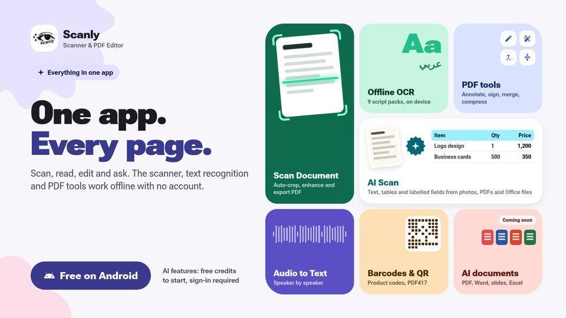

<div align="center">

# Scanly

**Scanner & PDF editor for Android — one app, every page.**



<a href="https://play.google.com/store/apps/details?id=com.skeler.scanely">
  
</a>

**Coming soon to Google Play.** Scanly is in closed testing; the store page opens to everyone at launch.

[](LICENSE)
[](#tech-stack)
[](#tech-stack)

</div>

## What it does

Scan, read, edit and ask. The scanner, text recognition and PDF tools work **offline, with no account**.

| | |
|---|---|
| **Scan Document** | Auto-crop, enhance and export to PDF. |
| **Offline OCR** | Text recognition on the phone itself — 9 script packs, Arabic included. Nothing is uploaded. |
| **PDF tools** | 25 offline tools: merge, split, compress, convert to and from Word, PowerPoint, Excel and JPG, sign, watermark, protect and more. |
| **AI Scan** | Text, tables and labelled fields from photos, PDFs and Office files. |
| **Audio to Text** | Transcripts that show who said what, speaker by speaker. |
| **Barcodes & QR** | Product codes, QR codes and PDF417, with an action for each one: open a link, join Wi-Fi, save a contact. |
| **AI documents** | *Coming soon:* PDF, Word, slides and Excel files made for you. |

**AI features** start with free credits and need a sign-in. Everything else works without one.

## Privacy

- Offline OCR, the document scanner, barcodes and the PDF tools run entirely on your phone.
- A page or recording leaves the phone only when you use an AI feature, and only to process that request.
- Full details: [scanlyocr.com/privacy](https://scanlyocr.com/privacy).

## Tech stack

- **App:** Kotlin, Jetpack Compose (Material 3 Expressive), Hilt, Room, CameraX, WorkManager.
- **On-device OCR:** PaddleOCR PP-OCRv6 models on ONNX Runtime; ML Kit as a second engine.
- **Barcodes:** ML Kit and ZXing-C++ (choose either in Settings).
- **PDF engine:** PDFium for rendering and text, qpdf (built from source with the NDK) for page surgery and encryption, Bouncy Castle and PDFBox for digital signatures.
- **Backend:** accounts, credits and AI features talk to Scanly's hosted API. The server code is not part of this repository.

## Project layout

| Folder | What is in it |
|---|---|
| `app/` | The Android app. Native PDF code is in `app/src/main/cpp`. |
| `baselineprofile/` | Baseline Profile generator for faster startup. |
| `contracts/` | API response samples the app's unit tests read. |
| `scripts/` | The generator for the PDF tools icons. |

## Building the app

You need JDK 21, the Android SDK (compileSdk 37) with the NDK and CMake 3.31.6.

```bash
./gradlew assembleDebug        # debug APK
./gradlew testDebugUnitTest    # unit tests
```

A debug build works without any keys. Sign-in and AI features need your own Firebase project
(`app/google-services.json`) and access to the backend. Release builds also need a signing key in
`local.properties`. None of these are in the repository.

## License

Copyright 2026 Azyrn.

Licensed under the [Apache License 2.0](LICENSE). See [NOTICE](NOTICE) for the third-party components
and their licences. The Scanly name and logo are not covered by the licence and may not be used for
other apps.
